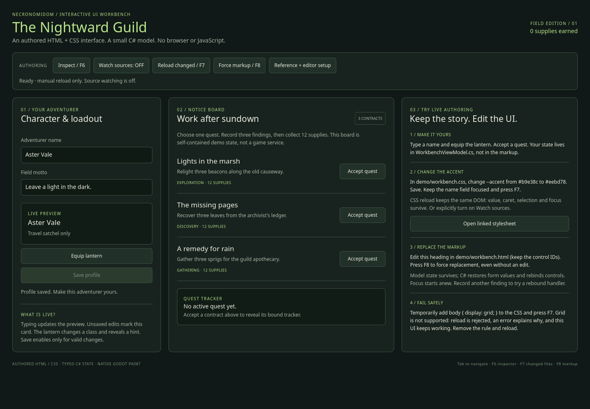
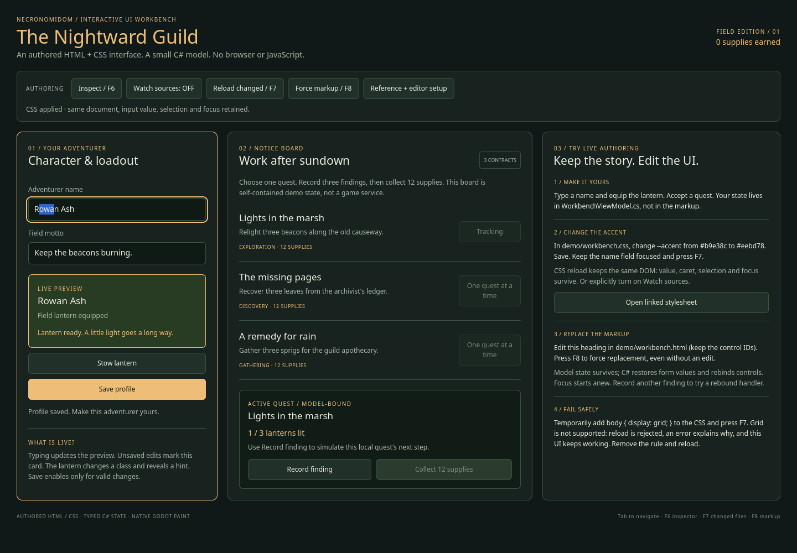
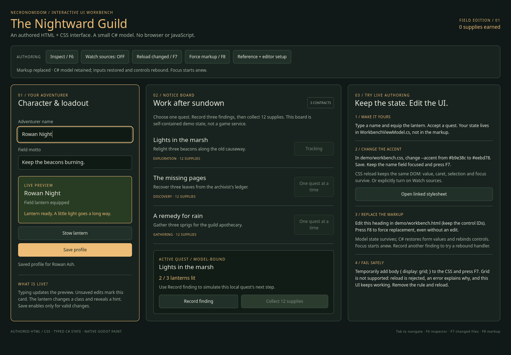
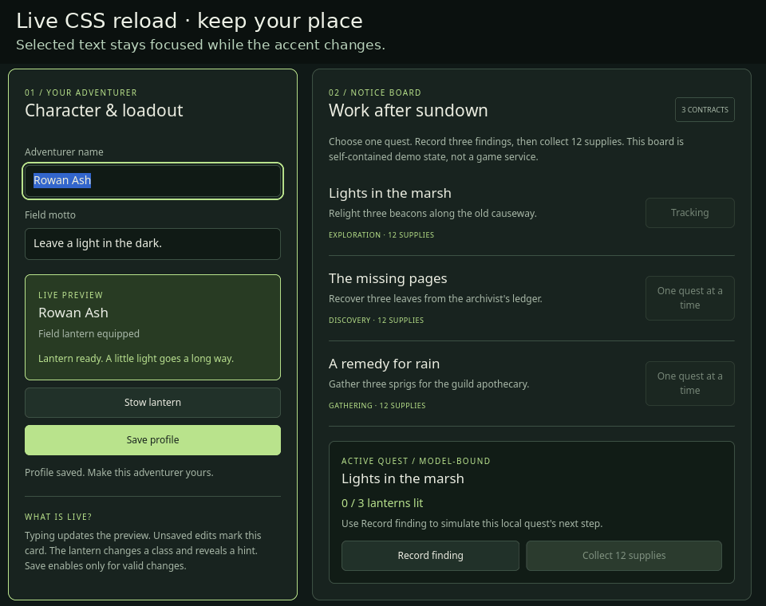
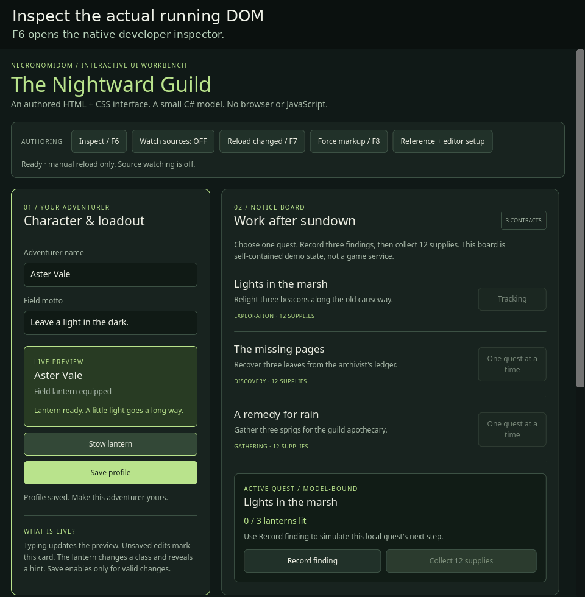
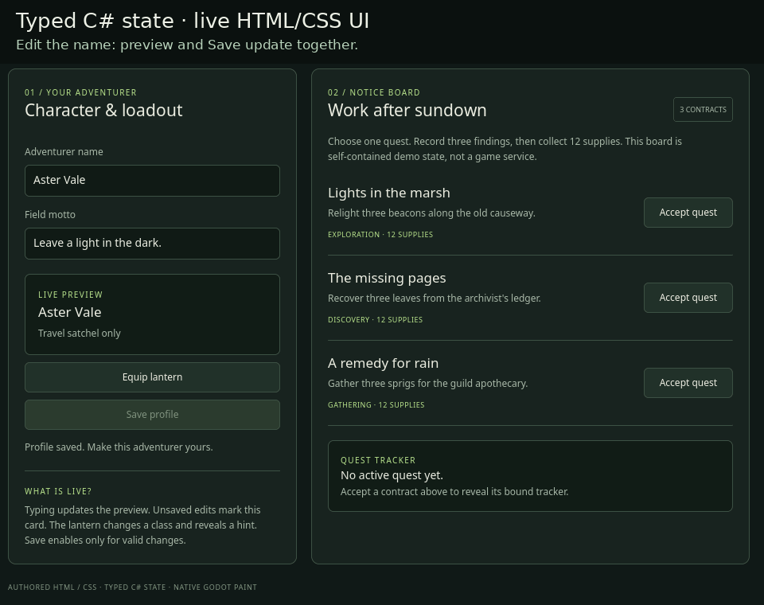
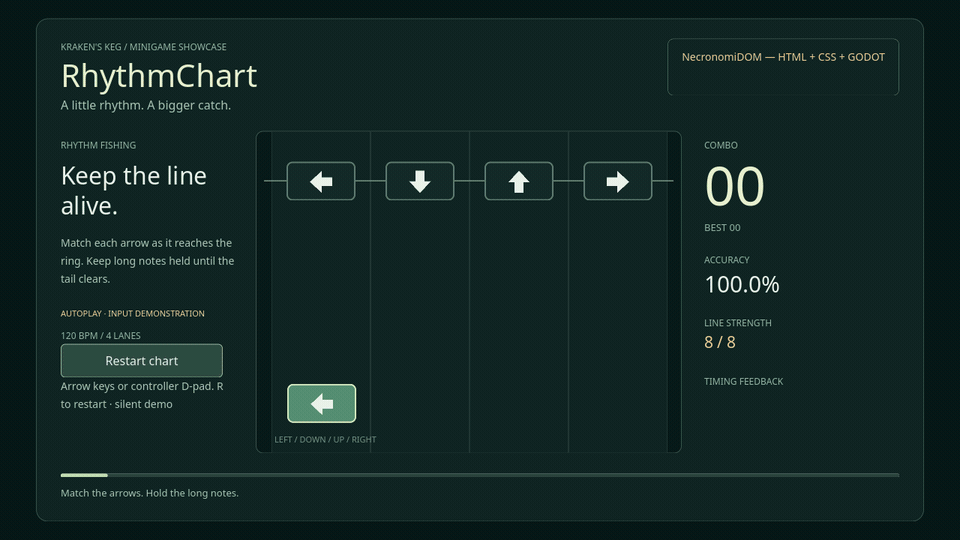
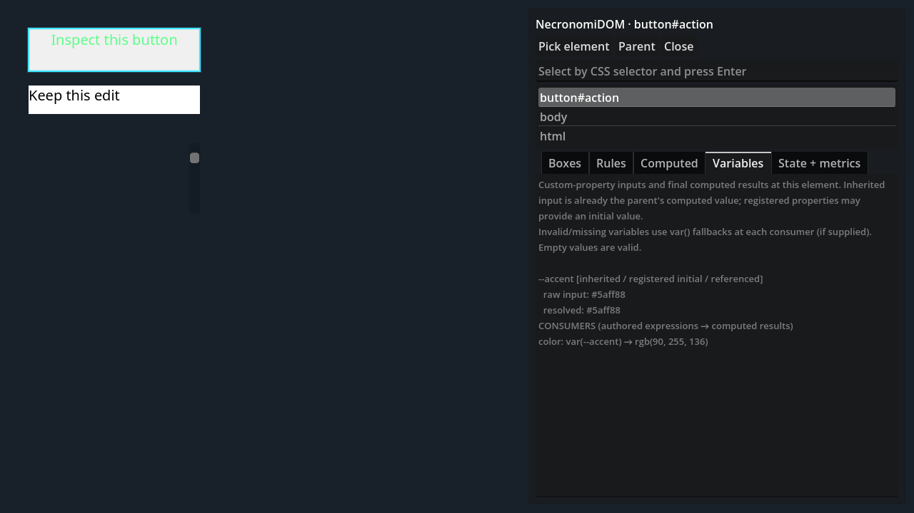
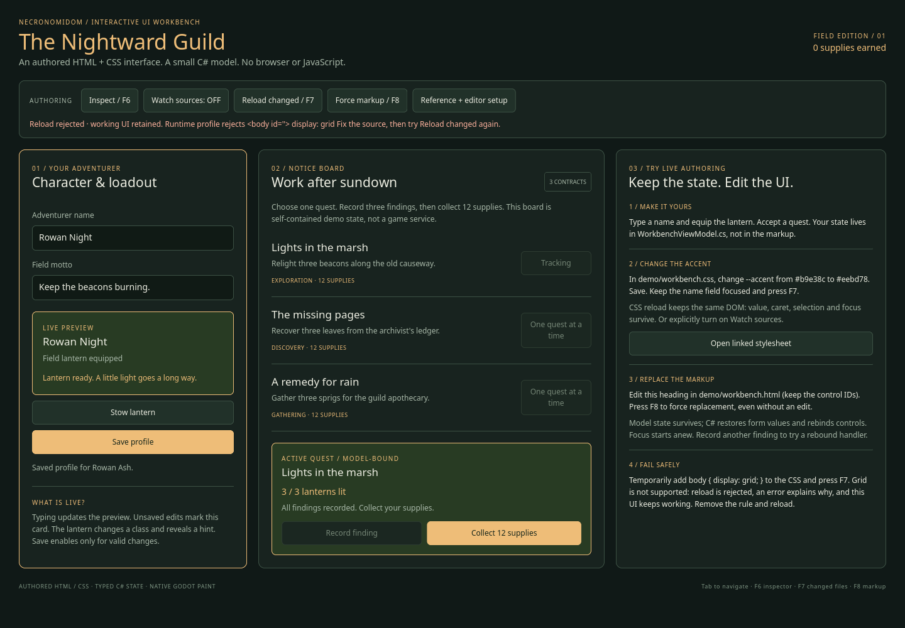

# NecronomiDOM

HTML and CSS user interfaces for Godot 4, from GDScript or C#. Author screens as ordinary `.html` and `.css` files; NecronomiDOM
parses them into a live DOM, runs the CSS cascade, lays the document out and paints it natively through Godot's
`RenderingServer` and `TextServerAdvanced`, with pointer, keyboard, gamepad and screen-reader support.

**Inspired by [Valve’s Panorama UI framework](https://developer.valvesoftware.com/wiki/Panorama/Overview), built independently for Godot.**

[Download the addon](https://github.com/Eldritch-Game-Studio/NecronomiDOM/releases/latest) · [Installation](#add-it-to-your-project) · [Examples](#try-the-demos) · [Supported HTML/CSS](docs/capabilities.md)

| Default workbench | Live CSS edit, retained focus | Markup reload, rebound controls |
|---|---|---|
|  |  |  |

The Nightward Guild workbench combines editable forms, typed state bindings and live HTML/CSS authoring.
Run it from the source repository with Godot .NET, or try the smaller GDScript Grimoire in `demo/gdscript/`.

## Live interfaces, not just menus

### Live CSS reload, without losing your place



Change the linked stylesheet and press **F7**: the accent updates while the same document, input value, selection and focus remain intact. Keep typing without clicking back into the field.

### Pick and inspect the running DOM



Open the debug inspector with **F6**, pick an element in the running interface, and inspect its ancestry, matched CSS rules and computed values alongside the highlighted element.

### Typed C# state, visible in the interface



Ordinary input and click handlers update a C# model. Typed one-way bindings refresh text, classes, visibility and enabled states as you edit a profile, equip a lantern and complete a local demo quest.

These three recordings use the actual Nightward Guild workbench in Godot 4.7.2 .NET with Forward+ rendering. Captions are outside the interface; the quest board uses self-contained demo state, not a game service.

### Continuously updating interfaces



HTML/CSS can drive continuously changing game interfaces—not just static screens. This recording demonstrates:

- **Live DOM updates:** C# creates elements, updates text and changes styles while the interface is running.
- **Positioned layout:** independently moving elements and variable-height indicators inside a clipped playfield.
- **CSS geometry and styling:** arrow shapes built from polygons and rectangles, 2D transforms, borders and rounded corners.
- **State-driven feedback:** class changes restyle active elements and status text; numeric readouts and a progress bar update alongside them.
- **Native Godot rendering:** every visible UI element is painted through NecronomiDOM, without a browser or native UI widgets.

Movement and feedback are driven by C# updating the DOM, not CSS keyframe animations.

### Addon capabilities

- **DOM**: elements, attributes, events (`click`, pointer, keyboard, focus, input), `MutationObserver`, custom
  elements, shadow roots in the DOM API, CSSOM and CSS Typed OM from C#; a selector-based API and signals from
  GDScript.
- **HTML**: standards-based parsing (a patched copy of [AngleSharp](https://github.com/AngleSharp/AngleSharp)); no
  scripting, no network.
- **CSS**: selectors (including `:is`, `:where`, `:not`, `:has`, `:focus-visible`, `:hover`), custom properties,
  `@media`, `@font-face`, nesting, computed values from the W3C property grammars.
- **Layout**: block/flow-root, relative and absolute positioning, flexbox (row/column, wrapping rows), images,
  inline text with wrapping and ellipsis, overflow scrolling with scrollbars, 2D transforms.
- **Paint**: backgrounds, gradients, background images, borders, rounded corners, `clip-path`, opacity, text strokes
  and shadows, transitions of opacity, colors, width and scale.
- **Input**: mouse and pointer capture, keyboard focus and Tab order, gamepad/arrow navigation between focusable
  elements, `<input>`/`<textarea>` editing with caret and selection.
- **Accessibility**: the DOM's accessibility tree is exposed through Godot's `AccessibilityServer`, subject to the
  [text and accessibility limits](#text-and-accessibility-limits) below.

## HTML/CSS or Godot's built-in UI?

Use NecronomiDOM when you prefer to author and theme game interfaces in HTML/CSS. Use Godot's
`Control` nodes and `Theme` resources when a scene-based workflow or built-in widgets fit your project.
Both approaches render within Godot; NecronomiDOM changes how you author the interface.

| | Godot `Control` + `Theme` | NecronomiDOM |
|---|---|---|
| Authoring | Nodes edited in the inspector, saved as `.tscn`/`.tres` | Plain `.html` + `.css` in any editor |
| Styling a state (hover, focus, disabled) | Separate `StyleBox` per state per control type, or overrides on each node | One selector: `button:focus { border-color: … }` |
| Reuse and theming | Theme inheritance and type variations | Cascade, classes, custom properties (`--accent`), `@media` |
| Layout | Containers nested per axis, plus anchors and size flags | Flexbox, padding, positioning, percentages |
| Who can work on it | Godot users | Anyone who knows HTML and CSS, including web designers |
| Reviewing changes | Diffs of serialized resources with generated IDs | Readable markup and stylesheet diffs |
| Dynamic content | Instance and free nodes, re-apply overrides | Change the DOM (`TextContent`, `SetAttribute`, `classList`) and the layout updates |
| Gamepad and keyboard | Configure each control's focus neighbors | Tab order and directional navigation come from the document |
| Accessibility | Per-control properties | Roles, names and supported states derived from HTML semantics and ARIA |

Compare a styled, focus-aware button. With built-in nodes you create a `Button`, then a `StyleBoxFlat` for each of
normal, hover, pressed and focus, set colors, borders and corner radii on each, and assign them as theme overrides.
In NecronomiDOM:

```css
button { padding: 8px 12px; border: 2px solid #4a7a60; border-radius: 8px; background-color: #22342c; }
button:hover { background-color: #304a3e; }
button:focus { border-color: #96dcaa; }
```

That rule then applies to every button in every document.

**When to stay with built-in `Control`s:** editor plugins or interfaces that need widgets outside the
supported profile, such as trees, item lists, rich text and color pickers. NecronomiDOM supports a defined
subset of HTML and CSS (see [Supported profile](#supported-profile)) and reports unsupported features while authoring.

## Requirements

- **Godot 4.7.2**, standard or .NET edition.
- Prebuilt native libraries for **Windows x64**, **Linux x64/ARM64**, and **macOS Intel/Apple silicon**.
- **Godot .NET** if you want the full C# DOM API. GDScript projects do not need .NET.

| | GDScript API | C# DOM API |
|---|---|---|
| Godot edition | Standard or .NET | .NET |
| Access | `DocumentHost` node, selector methods and signals | DOM, CSSOM, layout and typed state bindings |
| Setup | Install the release ZIP and restart Godot | Also import `NecronomiDom.targets` into your project and build |

The native GDExtension is compiled ahead of time, so GDScript users do not need a .NET runtime or SDK.
Android, iOS and Web native exports are not supported.

## Add it to your project

### 1. Download and install

Download the **NecronomiDOM addon ZIP** from the [latest GitHub release](https://github.com/Eldritch-Game-Studio/NecronomiDOM/releases/latest).
Choose the attached `NecronomiDOM-v….zip` file under **Assets**, not GitHub's automatic **Source code** archives.

Extract its `addons/necronomidom/` folder into your project as `res://addons/necronomidom/`, then restart
Godot to load the extension. The release ZIP includes the native libraries for all five desktop architectures.

A repository clone or automatic source archive does not include those binaries. Use the release ZIP
for installation; see [Building from source](#building-from-source) if you want to compile them yourself.

### 2. GDScript projects: done

Add a **DocumentHost** node (search for it in **Add Node**) under a `CanvasLayer` and set its **Document Path**.

### 3. C# projects: add one line to your `.csproj`

C# projects can use the GDScript API as is. For the C# DOM API, open your project's `.csproj` (next to
`project.godot`) and add the `Import` line before `</Project>`:

```xml
<Project Sdk="Godot.NET.Sdk/4.7.2">
  <PropertyGroup>
    <TargetFramework>net8.0</TargetFramework>
    <EnableDynamicLoading>true</EnableDynamicLoading>
  </PropertyGroup>
  <Import Project="addons/necronomidom/NecronomiDom.targets" />
</Project>
```

Godot gives addons no way to change a project's build, so this one step is manual. The import references the core
library as its own assembly and compiles the Godot glue (`addons/necronomidom/runtime/`) into your game; build with
the editor's **Build** button or `dotnet build`. In C#, attach `res://addons/necronomidom/runtime/DocumentHost.cs` to a
`Control` to get the C# class.

### 4. Recommended setting

Turn off **Project Settings → GUI → Common → Snap Controls to Pixels**
(`gui/common/snap_controls_to_pixels=false`); documents position boxes and glyphs at fractional pixels.

### Updating

Replace `addons/necronomidom/` with the new version and restart the editor (C#: rebuild).

## Use

Put a `DocumentHost` under a `CanvasLayer` and point it at a document:

```
Main (Node)
└── UI (CanvasLayer)
    └── Document (DocumentHost)
        document_path = "res://ui/menu.html"
```

```html
<!doctype html>
<html><head><link rel="stylesheet" href="menu.css"></head>
<body><main><p id="status">Ready.</p><button id="start" autofocus>Start</button></main></body></html>
```

### From GDScript

```gdscript
extends Node

@onready var ui: DocumentHost = $UI/Document

func _ready() -> void:
    ui.clicked.connect(_on_clicked)
    ui.cancel.connect(get_tree().quit)

func _on_clicked(element_id: String) -> void:
    if element_id == "start":
        ui.set_text("#status", "Started.")
```

Elements are addressed by CSS selector (the first match); events report the `id` of the clicked element or its
nearest ancestor with one.

| Member | Purpose |
|---|---|
| `document_path`, `load_document(path)` | Document to show (`res://…`, or `user://ui/…`). |
| `get_text` / `set_text(selector, text)` | Element text content. |
| `get_attribute` / `set_attribute` / `remove_attribute(selector, name, …)` | Attributes. |
| `has_class` / `add_class` / `remove_class` / `toggle_class(selector, class)` | Classes, which drive your CSS. |
| `get_value` / `set_value(selector, value)` | `<input>` / `<textarea>` / `<select>` values. |
| `focus_element(selector)`, `has_element(selector)`, `query_ids(selector)` | Focus, existence, ids of all matches. |
| `listen(type)` + signal `dom_event(type, element_id)` | Any other DOM event, e.g. `"input"`, `"focusin"`. |
| signals `clicked(element_id)`, `cancel()` | Clicks; Escape or the cancel action. |
| `set_input_enabled(bool)`, `set_application_navigation(bool)`, `apply_text_scale(float)` | Input and scaling (see the table below). |
| `font_path`, `font_family`, `font_paths`, `fallback_font_paths` | Fonts (see the table below). |
| `submit_action`, `cancel_action`, `navigate_*_action` | Input actions. |
| `append_html(selector, html)`, `insert_html_before(selector, html)`, `set_inner_html(selector, html)` | Parse fragments into the live document; only `set_inner_html` replaces existing descendants. |
| `remove_element(selector)`, `move_element(selector, parent_selector, before_selector = "")` | Remove or reorder existing elements without replacing unrelated rows. |
| `get_checked` / `set_checked(selector, bool)`, `get_selected_index` / `set_selected_index(selector, int)` | Live checkbox/radio and select state. |
| `get_style` / `set_style(selector, property, value)` | Inline CSS properties, including custom properties. |
| `get_scroll(selector)`, `scroll_to(selector, x, y)`, `get_element_rect(selector)` | Live scroll offset and published border-box bounds in host-local CSS pixels. Await layout after structural edits. |
| `get_active_element_id()`, `element_from_point(x, y)` | Focus identity and physical hit-test identity (nearest ancestor with an ID). |
| `set_pointer_capture` / `release_pointer_capture` / `has_pointer_capture(selector, pointer_id)` | Capture the active pointer reported by `pointerdown`. |
| `listen(type)` + `dom_event_detail(type, element_id, details)` | Event payload: modifiers, pointer position/buttons/ID/type, keyboard key/code/repeat and target form state as applicable. Existing signals are unchanged. |

These incremental bridge additions are source-only until a package built from this revision is supplied.
Do not combine an updated manifest or scripts with older platform libraries: each target must contain the same
bridge revision. HTML fragments use the existing parser and DOM mutation machinery, not a document reload.
Unchanged elements retain their identity, focus, scroll and pointer capture.
The native `DocumentHost` is registered for both runtime and editor use, so `@tool` GDScript
plugins can use this same bridge in the standard, non-.NET Godot editor.

### From C#

With the `.csproj` import (step 3), attach `DocumentHost.cs` instead of using the native node, and the C# class
exposes the whole DOM:

```csharp
using NecronomiDom.Dom;
using NecronomiDom.Runtime;

public partial class Main : Godot.Node
{
    public override void _Ready()
    {
        var host = GetNode<DocumentHost>("UI/Document");
        host.Document.GetElementById("start")!.AddEventListener("click",
            new DelegateEventListener(_ => host.Document.GetElementById("status")!.TextContent = "Started."));
        host.CancelRequested += () => GetTree().Quit();
    }
}
```

A host under a `CanvasLayer` fills the viewport; a host under another `Control` fills that parent. Call
`LoadDocument(path)` to switch documents. DOM changes made from C# re-layout on the next frame (or immediately via
`FlushPendingLayout()`).

### Managed Typed OM geometry

`HTMLElement.AttributeStyleMap` accepts numeric and transform values without formatting CSS text.
For frequently changing convex clips, the managed `CSSPolygonValue` extension accepts a reusable
`IReadOnlyList<CSSPolygonPoint>` containing finite `CSSUnitValue` coordinates in `px` or `percent`:

```csharp
using NecronomiDom.Css.TypedOm;

var points = new[] {
    new CSSPolygonPoint(new(0, "px"), new(0, "px")),
    new CSSPolygonPoint(new(100, "percent"), new(0, "px")),
    new CSSPolygonPoint(new(50, "percent"), new(100, "percent"))
};
var polygon = new CSSPolygonValue(points);
element.AttributeStyleMap.Set("clip-path", polygon);
points[1] = new(new(80, "percent"), new(0, "px"));
element.AttributeStyleMap.Set("clip-path", polygon);
```

Assignment validates all coordinates before mutation and copies them into declaration-owned storage.
Changing the caller's list alone does not change any declaration; multiple elements can safely share
that scratch list. Same-vertex-count writes reuse retained storage without parsing or allocating a
new declaration value; unchanged coordinates do not invalidate paint. `Get("clip-path")` exposes an isolated snapshot through `TryGetPolygon`.
The extension uses the default nonzero fill rule and at least three vertices; percentages resolve
against the final border box. Painting retains the existing convex-polygon validation and immutable
paint/hit geometry, including viewport resizing and retained in-place clip updates. Parsed string
`polygon(...)` values remain supported through the existing CSS API.


### `DocumentHost` settings (C# names)

| Member | Default | Purpose |
|---|---|---|
| `DocumentPath` | `""` | Document loaded on ready (`res://…`, or `user://ui/…`). |
| `FontFamily` / `FontPath` | `"Noto Sans"` / bundled `fonts/NotoSans-Regular.otf` | Family available to `font-family`. |
| `FontPaths` | empty | More family → font file mappings (`@font-face` in stylesheets also works). |
| `FallbackFontPaths` | empty | Ordered fonts searched for characters a family lacks (CJK, symbols). |
| `SubmitAction`, `CancelAction` | `ui_accept`, `ui_cancel` | Gamepad confirm / cancel actions. |
| `NavigateLeftAction` … `NavigateDownAction` | `ui_left` … `ui_down` | Directional focus navigation. |
| `ApplicationNavigation` | `false` | Your code owns directional navigation; the document does not move focus. |
| `InputEnabled` | `true` | Suspend input (e.g. while a modal covers the host); also releases focus and pointer capture. |
| `CancelRequested` | event | Escape or `CancelAction` pressed while the host accepts input. |
| `ApplyTextScale(float)` | `1` | Scale the whole document for a text-size setting; `TextScaleGroup` reaches every host. |
| `DocumentLive` / `DocumentWithdrawing` | static events | Observe every live document (e.g. global click sounds). |

Stylesheet extensions: `--necronomidom-selection-color` (text selection highlight), `--necronomidom-scrollbar-size`,
`-inset`, `-radius`, `-track`, `-thumb`, `-thumb-hover` (scrollbar styling), and the application media features
`-necronomidom-input` (default `keyboard`) and `-necronomidom-platform` (default `desktop`). Change them by assigning
a new environment, which re-cascades the document:

```csharp
var media = new NecronomiDom.Css.Media.MediaEnvironment();
media.Features["-necronomidom-input"] = "gamepad";   // matches @media (-necronomidom-input: gamepad)
host.Styles.Media = media;
```

### Typed C# state bindings

`host.CreateBindings()` creates a `NecronomiDom.Bindings.DocumentBindings` scope for the host's
currently live document. Sources implement ordinary `INotifyPropertyChanged`; getters are typed
delegates, not reflection, markup expressions or scripts. For example, the workbench presenter
binds its view model's text with:

```csharp
var bindings = host.CreateBindings();
bindings.Text("#character-preview", model, nameof(WorkbenchViewModel.CharacterPreview), state => state.CharacterPreview);
```

| Method | One-way target |
|---|---|
| `Text(selector, source, property, getter)` | Literal `textContent`, never HTML or an input's `value`. |
| `Class(selector, className, source, property, getter)` | Presence of one class token; other classes remain intact. |
| `Visible(selector, source, property, getter)` | Inverse `hidden` attribute. Author CSS must honor `[hidden]`, e.g. `[hidden] { display: none !important; }`. |
| `Enabled(selector, source, property, getter)` | Inverse `disabled` attribute on a button, input or textarea. |

Binding applies the initial value immediately. Later, only matching `PropertyChanged` notifications
read that getter (`null`/empty property means all); unchanged values do not rewrite the DOM.
Selectors resolve once to connected elements in this exact document. Missing/detached targets,
invalid tokens and getter failures throw `BindingException` with the source type/property,
target selector/property and original inner failure. Create, notify and dispose on the owning UI
thread; marshal background model notifications before publishing them.

The scope automatically unsubscribes and releases its document references on host withdrawal.
CSS-only reload keeps the scope. Markup reload needs a fresh scope and bindings on the replacement
document. Manual `Dispose()` also unsubscribes; `IsDisposed` and `Disposed` expose that lifetime.
For non-Godot DOM consumers, `new DocumentBindings(document)` is available with caller-owned disposal.

Bindings never write back to models. Keep clicks and edits as explicit application commands, and
detach those handlers as part of the presenter's document lifetime (the scope's `Disposed` event
can own that cleanup). See [`demo/Demo.cs`](demo/Demo.cs) and
[`demo/WorkbenchViewModel.cs`](demo/WorkbenchViewModel.cs): input events explicitly edit the model;
quest/loadout/save clicks remain ordinary handlers. Markup reload detaches/rebinds exactly once.

Typed state bindings are available from C#. GDScript uses the selector and signal API shown above.

## Developer authoring tools

The inspector and file reload are explicit opt-ins, available only in a debug engine/export template.
Ordinary hosts do not allocate an inspector, retain reload source snapshots or poll files.
The default C# workbench exposes them in its authoring toolbar, without requiring `--dev-ui`:
**F6** toggles the inspector, **F7** checks changed files, and **F8** reparses/remounts the document
even if files are unchanged. Its source watcher starts **off**. The smaller GDScript example still
uses `-- --dev-ui` to enable its keyboard authoring controls and automatic source watching.

### Live inspector



Select a live element to inspect its styles and state. The **Variables** tab shows inherited and resolved
custom properties, making it easier to trace values such as `--accent` through the cascade.

Call `host.OpenInspector()` from C#, or `host.open_inspector()` from GDScript. Use **Pick element**,
the ancestry list, **Parent**, or a CSS selector to select a connected element. The tabs show:

- Logical/visual bounds and HTML start-token provenance where available.
- Matched stylesheet paths, selectors, live CSSOM rules and actual cascade winners.
- Computed values, custom-property inputs/resolution and consumer fallback results.
- Focus/pointer/text-selection state, layout/paint counters and opt-in CPU host timings.

The overlay suspends this host's document input; picking does not click the underlying element.
**Close** or **Escape** restores prior input/focus when still applicable. Applications that poll
global game input directly must separately pause their gameplay controls while a tool is open.
CSSOM does not retain rule/declaration line-column offsets; the inspector says so rather than
inventing locations. Highlights are visual AABBs, not clipped polygons. Timings exclude inspector
work and are neither GPU timings nor whole-frame measurements.

Additional C# APIs: `AttachInspector()`, `ToggleInspector()`, `BeginInspectorPick()`,
`SelectInspectorElement(selector)`, `GetInspectorReport()`, `InspectorOpen`, `InspectorSelection`.
GDScript equivalents use snake_case; state getters are `is_inspector_open()` and
`get_inspector_selection()`. `pick_inspector_element(x, y)` takes document-local CSS pixels.

### File reload and document ownership

Set `DeveloperReloadEnabled = true` (`developer_reload_enabled` in GDScript) to poll the current
HTML and its linked stylesheets every 0.5 seconds. Content comparison catches same-timestamp edits.
Enabling on an existing document establishes a baseline from current disk contents without changing
that document; edits made before enabling require `ForceReload()`. Disabling releases the baseline.

For manual-only reload, set `DeveloperReloadWatchEnabled = false`
(`developer_reload_watch_enabled` in GDScript) **before** enabling `DeveloperReloadEnabled`.
This retains the baseline and manual commands without polling. Toggling the watch property does
not clear the baseline or enable reload by itself; its default is `true` to preserve existing
opted-in hosts. The workbench's **Watch sources: OFF/ON** button is the explicit automatic-watch opt-in.

`ReloadChangedFiles()` preserves the exact DOM, input values/selections, focus, listeners and scroll
state for CSS-only edits; changed geometry can naturally clamp scroll offsets. It validates candidate
layout/native paint in an isolated snapshot using the current media environment before publishing
styles. Invalid CSS/resource edits report failure and leave the current UI intact during preparation.
Developer operations require a mounted host with a nonzero viewport, and use bounded local file reads.
`@import` remains outside the runtime profile; reload does not silently enable unsupported CSS.

Changed HTML or `ForceReload()` withdraws the old document and publishes a replacement. Discard old
element handles and bind the new document explicitly:

```csharp
host.ReloadCompleted += result =>
{
    if (result.DocumentReplaced) BindDocument();
};
host.DeveloperReloadWatchEnabled = false; // manual commands only; enable watching separately
host.DeveloperReloadEnabled = true;
```

GDScript methods `reload_changed_files()` / `force_reload()` return the kind, and signal
`developer_reloaded(kind, document_replaced, error)` supplies the details. Kinds:
Disabled=0, Unchanged=1, Styles=2, Document=3, Failed=4. Automatic idle checks are silent.
Preparation is isolated; application callback exceptions or failures during actual mounting are
not a transactional rollback of arbitrary application state.

### Generated capability reference

[Renderable capabilities](docs/capabilities.md) distinguish parser acceptance from actual
layout/paint/input admission and context-dependent restrictions. Runtime validation and the generator
share the same admission manifest; named native APIs/signals come from their binding annotations.

```sh
python3 scripts/generate-capabilities.py          # regenerate reference and editor data
python3 scripts/generate-capabilities.py --check  # CI: fail on stale/missing generated output
```

`docs/generated/necronomidom.css-data.json` and `necronomidom.html-data.json` are VS Code custom-data
files. Add them to `css.customData` / `html.customData` in workspace settings. They supplement
completion/documentation; they do not suppress every unsupported browser suggestion.

### Incremental style reconciliation

Class, pseudo-state (including hover), and tree changes still rematch selectors. When stylesheet
sources remain unchanged, specified and computed values can independently reuse proven inputs
instead of discarding their snapshots merely because rule matching changed. Whole-document
restyles from relational selectors (`:has()`) or shadow trees do not advance the source epoch.
Added and removed declarations, inheritance, direction, and context-dependent values still
recompute; stylesheet and explicit environment changes retire the old source-generation proof.

Inactive `@media` branches do not widen ordinary mutations into whole-document restyles.
Their query results remain observed: crossing a viewport breakpoint or explicitly invalidating
media features rescans selector dependencies before the next style read. Dynamic media providers
retain conservative invalidation.

`StyleComputedReuseTests` compares incremental results with full computation, including class/hover
toggles, structural selectors, sibling numeric inputs, and source/media invalidation. Run the focused
suite from the repository root:

```sh
dotnet test tests/NecronomiDom.Tests/NecronomiDom.Tests.csproj --filter FullyQualifiedName~StyleComputedReuseTests
```

### Packaging for a managed host

For a .NET host that supplies its native integration, commit source changes and run
`python3 scripts/package-managed.py`. It rebuilds the Release demo and writes
`dist/necronomidom-managed-<commit>.zip`: deterministic committed addon source with
per-file hashes and upstream provenance in `addon-package.json`. The host compiles
the source through `NecronomiDom.targets`. This profile omits GDExtension registration
and native binaries, preventing duplicate registration in engines with embedded modules.
It is not the standalone GDScript/native release; that release still uses the native
build and final-ZIP qualification workflow.
Host-generated `.import` files are excluded; installing this package preserves the host's asset-import settings.

## Supported profile

NecronomiDOM implements a deliberate subset of the web platform and refuses the rest loudly: content outside the
profile throws `NotSupportedException` naming the element, property or rule, instead of rendering something
approximate.

- Elements: `html`, `body`, `div`, `main`, `section`, `p`, `span`, `button`, `a`, `img` (PNG/JPEG/WebP),
  `input` (text types), `textarea`.
- Stylesheets: `<style>`, `<link rel="stylesheet">`, style rules, `@media`, `@font-face`, nesting.
- Text: left-to-right, integer `px` font sizes, regular faces with synthesized bold/italic.
- Not supported: scripts, network URLs, `float`, grid, tables, `position: fixed/sticky`, `z-index`, column-wrapped
  flex, 3D transforms, vertical margins in normal flow (use padding or flex), pseudo-elements.

Because block margins do not collapse, the browser default margin on `<p>` is rejected too. Start every stylesheet
with a reset:

```css
html, body, main, section, div, p, button, input, textarea { margin: 0; box-sizing: border-box; }
```

Resource URLs resolve inside `res://` (and `user://ui/`); anything else is rejected.

## Text and accessibility limits

Text uses Godot's standard shaping. Screen readers receive supported DOM roles, names and states
through Godot's `AccessibilityServer`. Mixed checkbox and `aria-invalid` states are not exposed.

## Try the demos

The source repository includes two examples:

- **Nightward Guild** (`demo/demo.tscn`): a C# workbench with editable character/loadout controls,
  a local quest board, a tracker and live authoring tools.
- **The Grimoire** (`demo/gdscript/demo.tscn`): a smaller GDScript example with buttons and live DOM updates.

Clone the repository to get the full demo project, then install the addon from the
[latest release](https://github.com/Eldritch-Game-Studio/NecronomiDOM/releases/latest) into that clone:

```sh
git clone https://github.com/Eldritch-Game-Studio/NecronomiDOM.git
cd NecronomiDOM
```

For Nightward Guild, open the project with **Godot .NET**, build the C# project and run the main scene.
For the GDScript example, open `demo/gdscript/demo.tscn` and run that scene, or launch it directly:

```sh
godot --path . res://demo/gdscript/demo.tscn
```

The installable ZIP contains the addon, not the complete demo project.

### Explore the workbench

1. Edit the adventurer's name and motto, then equip the lantern. Text and class bindings update the
   preview; visibility controls the lantern hint, and Save profile enables only for valid, changed input.
2. Accept a quest and record findings to advance its tracker. After three findings, collect the reward.
   The quest board is a self-contained example; its state lasts for the current session.
3. Change `--accent` in `demo/workbench.css`, keep an input focused, and press **F7**.
   The new stylesheet applies without losing the input's text, selection or focus.
4. Edit `demo/workbench.html`, keep its control IDs, and press **F8**. The document is replaced,
   while the presenter restores form drafts, rebinds controls and keeps the C# model.
5. Try an unsupported rule such as `body { display: grid; }`. The toolbar explains the error and keeps
   the working interface. Remove the rule and reload to continue.
6. Press **F6** to inspect the live DOM. **Reference + editor setup** opens the supported-feature
   reference and shows the VS Code HTML/CSS completion settings.

Source watching is optional and starts off. Inspector and reload controls are available in debug builds.



## Building from source

Prebuilt binaries are included in the [release downloads](https://github.com/Eldritch-Game-Studio/NecronomiDOM/releases).
To build a native library yourself, see the [native build guide](native/README.md) for toolchain requirements
and platform-specific instructions.

## License

MIT, see `LICENSE`. Third-party components and their licenses are listed in `THIRD_PARTY_NOTICES.md`.
