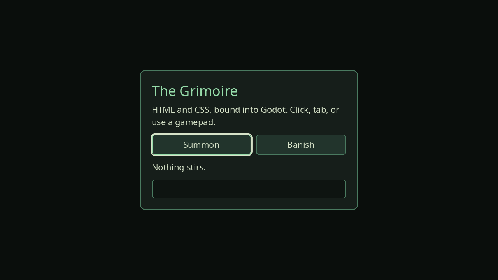
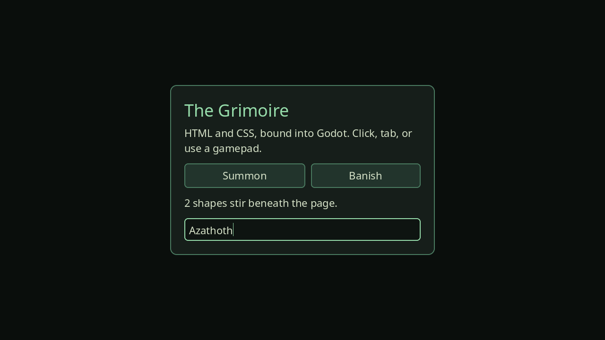
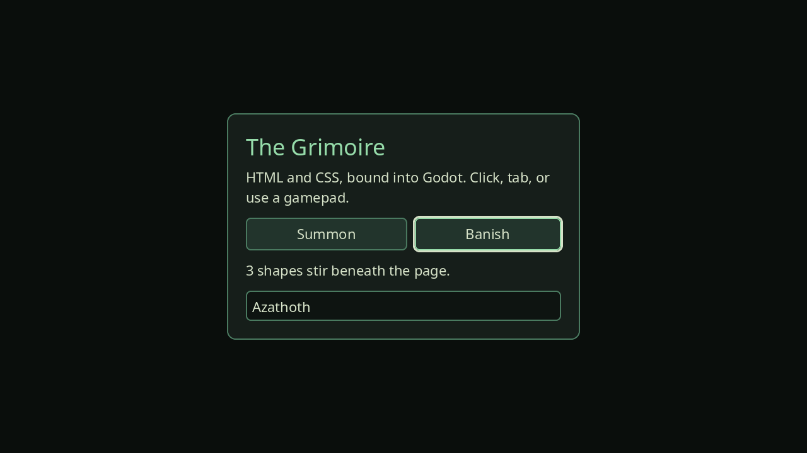
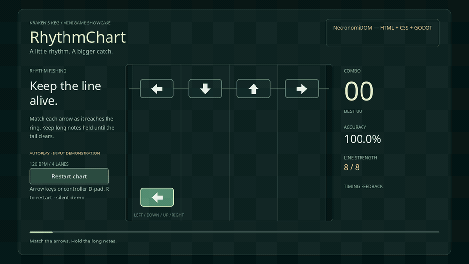

# NecronomiDOM

HTML and CSS user interfaces for Godot 4, from GDScript or C#. Author screens as ordinary `.html` and `.css` files; NecronomiDOM
parses them into a live DOM, runs the CSS cascade, lays the document out and paints it natively through Godot's
`RenderingServer` and `TextServerAdvanced`, with pointer, keyboard, gamepad and screen-reader support.

| Rendered | After clicks and typing | Gamepad navigation |
|---|---|---|
|  |  |  |

The demo (`demo/grimoire.html` + `grimoire.css`) rendered by stock Godot 4.7.2, Forward+, 1280×720.

## Live interfaces, not just menus



HTML/CSS can drive continuously changing game interfaces—not just static screens. This recording demonstrates:

- **Live DOM updates:** C# creates elements, updates text and changes styles while the interface is running.
- **Positioned layout:** independently moving elements and variable-height indicators inside a clipped playfield.
- **CSS geometry and styling:** arrow shapes built from polygons and rectangles, 2D transforms, borders and rounded corners.
- **State-driven feedback:** class changes restyle active elements and status text; numeric readouts and a progress bar update alongside them.
- **Native Godot rendering:** every visible UI element is painted through NecronomiDOM, without a browser or native UI widgets.

Captured in Godot 4.7.2 Forward+ using a standalone rhythm-interface adaptation from Kraken's Keg.
Movement and feedback are driven by C# updating the DOM, not CSS keyframe animations.

### Addon capabilities

- **DOM**: elements, attributes, events (`click`, pointer, keyboard, focus, input), `MutationObserver`, custom
  elements, shadow roots in the DOM API, CSSOM and CSS Typed OM from C#; a selector-based API and signals from
  GDScript.
- **HTML**: standards-based parsing (a patched copy of [AngleSharp](https://github.com/AngleSharp/AngleSharp)); no
  scripting, no network.
- **CSS**: selectors (including `:is`, `:where`, `:not`, `:has`, `:focus-visible`, `:hover`), custom properties,
  `@media`, `@font-face`, nesting, computed values from the W3C property grammars.
- **Layout**: block/flow-root, relative and absolute positioning, flexbox (row/column, wrapping rows), images,
  inline text with wrapping and ellipsis, overflow scrolling with scrollbars, 2D transforms.
- **Paint**: backgrounds, gradients, background images, borders, rounded corners, `clip-path`, opacity, text strokes
  and shadows, transitions of opacity, colors, width and scale.
- **Input**: mouse and pointer capture, keyboard focus and Tab order, gamepad/arrow navigation between focusable
  elements, `<input>`/`<textarea>` editing with caret and selection.
- **Accessibility**: the DOM's accessibility tree is exposed through Godot's `AccessibilityServer`.

## Why not Godot's built-in UI?

Godot's `Control` nodes and `Theme` resources work well for editor-style tools. Game interfaces built with them tend to
end up as deep scene trees, `StyleBoxFlat` resources and theme overrides spread across the inspector, and layout code
in `_Ready`. NecronomiDOM moves that work into the format most UI people already use.

| | Godot `Control` + `Theme` | NecronomiDOM |
|---|---|---|
| Authoring | Nodes edited in the inspector, saved as `.tscn`/`.tres` | Plain `.html` + `.css` in any editor |
| Styling a state (hover, focus, disabled) | Separate `StyleBox` per state per control type, or overrides on each node | One selector: `button:focus { border-color: … }` |
| Reuse and theming | Theme inheritance and type variations | Cascade, classes, custom properties (`--accent`), `@media` |
| Layout | Containers nested per axis, plus anchors and size flags | Flexbox, padding, positioning, percentages |
| Who can work on it | Godot users | Anyone who knows HTML and CSS, including web designers |
| Reviewing changes | Diffs of serialized resources with generated IDs | Readable markup and stylesheet diffs |
| Dynamic content | Instance and free nodes, re-apply overrides | Change the DOM (`TextContent`, `SetAttribute`, `classList`) and the layout updates |
| Gamepad and keyboard | Configure each control's focus neighbors | Tab order and directional navigation come from the document |
| Accessibility | Per-control properties | Roles, names and states derived from HTML semantics and ARIA |

Compare a styled, focus-aware button. With built-in nodes you create a `Button`, then a `StyleBoxFlat` for each of
normal, hover, pressed and focus, set colors, borders and corner radii on each, and assign them as theme overrides.
In NecronomiDOM:

```css
button { padding: 8px 12px; border: 2px solid #4a7a60; border-radius: 8px; background-color: #22342c; }
button:hover { background-color: #304a3e; }
button:focus { border-color: #96dcaa; }
```

That rule then applies to every button in every document.

**When to stay with built-in `Control`s:** editor plugins, UI that needs widgets outside the supported profile
(trees, item lists, rich text, color pickers), or projects not using C#. NecronomiDOM supports a defined subset of
HTML and CSS (see [Supported profile](#supported-profile)) and fails loudly on anything outside it, so you find gaps
while authoring instead of in a shipped build.

## Requirements

Godot 4.7 or newer, standard or .NET edition.

| | Standard Godot (GDScript) | Godot .NET edition |
|---|---|---|
| Runs on | Windows x64, Linux x64/arm64, macOS (Apple silicon and Intel) | Platforms Godot .NET exports to (desktop, Android, iOS) |
| API | `DocumentHost` node, selector methods, signals | The same, plus the full C# DOM, CSSOM and layout API |
| Setup | Copy the addon | Copy the addon, add one line to the `.csproj` |

The standard-edition build is a GDExtension: the same C# code compiled ahead of time into a native library, so
no .NET runtime or SDK is needed. Web, Android and iOS exports are not supported by it yet.

## Add it to your project

### 1. Get the addon

Download `NecronomiDOM.zip` from the [releases page](https://github.com/Eldritch-Game-Studio/NecronomiDOM/releases)
(or install from the Godot Asset Store) and copy its `addons/necronomidom/` folder into your project, so you have
`res://addons/necronomidom/`. Restart the editor so it loads the extension.

The release ZIP contains the prebuilt native libraries. A plain clone or GitHub source ZIP does not; build them with
`native/build.sh` (see [Building the native libraries](#building-the-native-libraries)).

### 2. GDScript projects: done

Add a **DocumentHost** node (search for it in **Add Node**) under a `CanvasLayer` and set its **Document Path**.

### 3. C# projects: add one line to your `.csproj`

C# projects can use the GDScript API as is. For the C# DOM API, open your project's `.csproj` (next to
`project.godot`) and add the `Import` line before `</Project>`:

```xml
<Project Sdk="Godot.NET.Sdk/4.7.2">
  <PropertyGroup>
    <TargetFramework>net8.0</TargetFramework>
    <EnableDynamicLoading>true</EnableDynamicLoading>
  </PropertyGroup>
  <Import Project="addons/necronomidom/NecronomiDom.targets" />
</Project>
```

Godot gives addons no way to change a project's build, so this one step is manual. The import references the core
library as its own assembly and compiles the Godot glue (`addons/necronomidom/runtime/`) into your game; build with
the editor's **Build** button or `dotnet build`. In C#, attach `res://addons/necronomidom/runtime/DocumentHost.cs` to a
`Control` to get the C# class.

### 4. Recommended setting

Turn off **Project Settings → GUI → Common → Snap Controls to Pixels**
(`gui/common/snap_controls_to_pixels=false`); documents position boxes and glyphs at fractional pixels.

### Updating

Replace `addons/necronomidom/` with the new version and restart the editor (C#: rebuild).

## Use

Put a `DocumentHost` under a `CanvasLayer` and point it at a document:

```
Main (Node)
└── UI (CanvasLayer)
    └── Document (DocumentHost)
        document_path = "res://ui/menu.html"
```

```html
<!doctype html>
<html><head><link rel="stylesheet" href="menu.css"></head>
<body><main><p id="status">Ready.</p><button id="start" autofocus>Start</button></main></body></html>
```

### From GDScript

```gdscript
extends Node

@onready var ui: DocumentHost = $UI/Document

func _ready() -> void:
    ui.clicked.connect(_on_clicked)
    ui.cancel.connect(get_tree().quit)

func _on_clicked(element_id: String) -> void:
    if element_id == "start":
        ui.set_text("#status", "Started.")
```

Elements are addressed by CSS selector (the first match); events report the `id` of the clicked element or its
nearest ancestor with one.

| Member | Purpose |
|---|---|
| `document_path`, `load_document(path)` | Document to show (`res://…`, or `user://ui/…`). |
| `get_text` / `set_text(selector, text)` | Element text content. |
| `get_attribute` / `set_attribute` / `remove_attribute(selector, name, …)` | Attributes. |
| `has_class` / `add_class` / `remove_class` / `toggle_class(selector, class)` | Classes, which drive your CSS. |
| `get_value` / `set_value(selector, value)` | `<input>` / `<textarea>` values. |
| `focus_element(selector)`, `has_element(selector)`, `query_ids(selector)` | Focus, existence, ids of all matches. |
| `listen(type)` + signal `dom_event(type, element_id)` | Any other DOM event, e.g. `"input"`, `"focusin"`. |
| signals `clicked(element_id)`, `cancel()` | Clicks; Escape or the cancel action. |
| `set_input_enabled(bool)`, `set_application_navigation(bool)`, `apply_text_scale(float)` | Input and scaling (see the table below). |
| `font_path`, `font_family`, `font_paths`, `fallback_font_paths` | Fonts (see the table below). |
| `submit_action`, `cancel_action`, `navigate_*_action` | Input actions. |

### From C#

With the `.csproj` import (step 3), attach `DocumentHost.cs` instead of using the native node, and the C# class
exposes the whole DOM:

```csharp
using NecronomiDom.Dom;
using NecronomiDom.Runtime;

public partial class Main : Godot.Node
{
    public override void _Ready()
    {
        var host = GetNode<DocumentHost>("UI/Document");
        host.Document.GetElementById("start")!.AddEventListener("click",
            new DelegateEventListener(_ => host.Document.GetElementById("status")!.TextContent = "Started."));
        host.CancelRequested += () => GetTree().Quit();
    }
}
```

A host under a `CanvasLayer` fills the viewport; a host under another `Control` fills that parent. Call
`LoadDocument(path)` to switch documents. DOM changes made from C# re-layout on the next frame (or immediately via
`FlushPendingLayout()`).

### `DocumentHost` settings (C# names)

| Member | Default | Purpose |
|---|---|---|
| `DocumentPath` | `""` | Document loaded on ready (`res://…`, or `user://ui/…`). |
| `FontFamily` / `FontPath` | `"Noto Sans"` / bundled `fonts/NotoSans-Regular.otf` | Family available to `font-family`. |
| `FontPaths` | empty | More family → font file mappings (`@font-face` in stylesheets also works). |
| `FallbackFontPaths` | empty | Ordered fonts searched for characters a family lacks (CJK, symbols). |
| `SubmitAction`, `CancelAction` | `ui_accept`, `ui_cancel` | Gamepad confirm / cancel actions. |
| `NavigateLeftAction` … `NavigateDownAction` | `ui_left` … `ui_down` | Directional focus navigation. |
| `ApplicationNavigation` | `false` | Your code owns directional navigation; the document does not move focus. |
| `InputEnabled` | `true` | Suspend input (e.g. while a modal covers the host); also releases focus and pointer capture. |
| `CancelRequested` | event | Escape or `CancelAction` pressed while the host accepts input. |
| `ApplyTextScale(float)` | `1` | Scale the whole document for a text-size setting; `TextScaleGroup` reaches every host. |
| `DocumentLive` / `DocumentWithdrawing` | static events | Observe every live document (e.g. global click sounds). |

Stylesheet extensions: `--necronomidom-selection-color` (text selection highlight), `--necronomidom-scrollbar-size`,
`-inset`, `-radius`, `-track`, `-thumb`, `-thumb-hover` (scrollbar styling), and the application media features
`-necronomidom-input` (default `keyboard`) and `-necronomidom-platform` (default `desktop`). Change them by assigning
a new environment, which re-cascades the document:

```csharp
var media = new NecronomiDom.Css.Media.MediaEnvironment();
media.Features["-necronomidom-input"] = "gamepad";   // matches @media (-necronomidom-input: gamepad)
host.Styles.Media = media;
```

## Supported profile

NecronomiDOM implements a deliberate subset of the web platform and refuses the rest loudly: content outside the
profile throws `NotSupportedException` naming the element, property or rule, instead of rendering something
approximate.

- Elements: `html`, `body`, `div`, `main`, `section`, `p`, `span`, `button`, `a`, `img` (PNG/JPEG/WebP),
  `input` (text types), `textarea`.
- Stylesheets: `<style>`, `<link rel="stylesheet">`, style rules, `@media`, `@font-face`, nesting.
- Text: left-to-right, integer `px` font sizes, regular faces with synthesized bold/italic.
- Not supported: scripts, network URLs, `float`, grid, tables, `position: fixed/sticky`, `z-index`, column-wrapped
  flex, 3D transforms, vertical margins in normal flow (use padding or flex), pseudo-elements.

Because block margins do not collapse, the browser default margin on `<p>` is rejected too. Start every stylesheet
with a reset:

```css
html, body, main, section, div, p, button, input, textarea { margin: 0; box-sizing: border-box; }
```

Resource URLs resolve inside `res://` (and `user://ui/`); anything else is rejected.

## Engine extensions

Two capabilities use engine APIs that stock Godot 4.7 does not expose. NecronomiDOM detects them at runtime:

- `FontFile.high_precision_shaping` (unhinted high-precision metrics). Without it, text metrics use Godot's standard
  shaping precision.
- `AccessibilityServer.update_set_checked_mixed` / `update_set_invalid_state`. Without them, mixed checkbox and
  `aria-invalid` states are not reported to screen readers.

## Demo and tests

The repository root is a Godot project with two demos of the same page: `demo/gdscript/demo.tscn` (GDScript, any
edition, needs the native library) and `demo/demo.tscn` (C#, .NET edition).

```sh
native/build.sh                                      # native library for this machine
godot --path . res://demo/gdscript/demo.tscn        # GDScript demo (add `-- --smoke` for a check run)
dotnet build NecronomiDOM.Demo.csproj
godot --path .                                       # C# demo (.NET edition)
godot --headless --path . -- --smoke                 # C# smoke run: exit 0 on success
dotnet test tests/NecronomiDom.Tests                 # core library tests (no engine required)
```

## Building the native libraries

`native/build.sh [RID…]` builds the GDExtension library for this machine (or the given runtime identifiers:
`linux-x64`, `linux-arm64`, `win-x64`, `osx-arm64`, `osx-x64`) into `addons/necronomidom/bin/` and writes
`addons/necronomidom/necronomidom.gdextension`. It needs the .NET 10 SDK and the C toolchain NativeAOT uses (clang on
Linux, Xcode on macOS, Visual Studio build tools on Windows), and fetches and builds the pinned
[Godot GDExtension .NET bindings](https://github.com/godotengine/godot-dotnet), which are not on NuGet yet. NativeAOT
only compiles for the OS it runs on; the CI/CD workflow builds every platform and assembles the release ZIP.

## Releasing

`.github/workflows/ci.yml` runs on every push and pull request: core tests, native libraries for every platform,
smoke runs of both demos (GDScript in standard Godot, C# in .NET Godot) and the addon ZIP as a build artifact.
Pushing a tag publishes a release:

```sh
git tag v0.1.0 && git push origin v0.1.0     # → GitHub release with NecronomiDOM-v0.1.0.zip
```

Two repository variables (Settings → Secrets and variables → Actions → Variables) choose where jobs run:

| Variable | Effect |
|---|---|
| `LINUX_RUNNER=self-hosted` | Linux x64 jobs (tests, Linux build, smoke runs, packaging) run on a self-hosted runner labelled `necronomidom` instead of GitHub-hosted Ubuntu. |
| `HOSTED_PLATFORMS=false` | Skip the GitHub-hosted Windows, macOS and Linux ARM builds; the ZIP is then named `*-partial.zip`. |

On a self-hosted runner, intermediate native binaries pass between jobs through the runner's local cache. The finished
ZIP is still uploaded to the workflow run's **Artifacts** section and retained in
`~/.cache/necronomidom-ci/dist/`. Version-tag runs also attach it to a GitHub release.

To run the same workflow without GitHub (Docker and [act](https://nektosact.com) required):

```sh
scripts/ci-local.sh        # tests, Linux x64 build, both smoke runs → dist/NecronomiDOM-<branch>-partial.zip
```

Local runs cover the Linux x64 jobs only (act has no Windows, macOS or ARM runners), so that ZIP holds only the
Linux x64 library.

Upload the release ZIP as a new version on the Godot Asset Store. The store has no upload API yet (its CLI for CI uploads is
on the [roadmap](https://store.godotengine.org/roadmap/)), so this last step is manual.

The runtime sources are shared: `native/` compiles `addons/necronomidom/runtime/` against the bindings with
`NECRONOMIDOM_GDEXTENSION` defined, and adds the GDScript API (`native/src/`).

## Layout of this repository

| Path | Contents |
|---|---|
| `addons/necronomidom/core/` | Engine-independent library: URL policy, DOM, HTML import, CSS, cascade, layout, display list. |
| `addons/necronomidom/runtime/` | Godot glue: `DocumentHost`, text shaping, paint, input, accessibility. |
| `addons/necronomidom/shaders/` | Canvas shaders used by the painter. |
| `addons/necronomidom/fonts/` | Default font (Noto Sans). |
| `addons/necronomidom/vendor/AngleSharp/` | Patched AngleSharp 1.8.4 HTML parser (see `patches/`). |
| `demo/` | Example document with C# and GDScript scenes. |
| `native/` | GDExtension build for standard Godot: project, GDScript API, build script. |
| `tests/` | NUnit tests for the core library. |

## License

MIT, see `LICENSE`. Third-party components and their licenses are listed in `THIRD_PARTY_NOTICES.md`.
